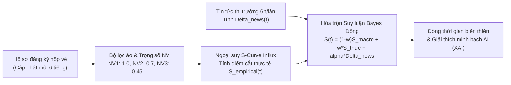

# KIẾN TRÚC VÒNG ĐỜI TUYỂN SINH & LUỒNG DỰ ĐOÁN ĐIỂM CHUẨN ĐỘNG UTC
*(UTC Dynamic Admission Timeline Pipeline Specification)*

Tài liệu này chuẩn hóa toàn bộ chu kỳ thời gian thực của mùa tuyển sinh Trường Đại học Giao thông Vận tải (UTC) và Bộ Giáo dục & Đào tạo, định nghĩa cách hệ thống AI/ML tiếp nhận dữ liệu, hiệu chỉnh mỏ neo, và cập nhật điểm chuẩn động liên tục từ lúc mở cổng tuyển sinh sớm cho đến khi đóng cổng kết thúc.

---

## 📌 TỔNG QUAN 3 MỐC THỜI GIAN LỚN TRONG CHU KỲ TUYỂN SINH

```mermaid
timeline
    title VÒNG ĐỜI DỰ BÁO ĐIỂM CHUẨN ĐỘNG THEO THỜI GIAN THỰC (UTC)
    section MỐC 1: XÉT TUYỂN SỚM (Tháng 3 - Tháng 6)
        Chưa thi THPT : Dùng điểm mỏ neo năm trước (2025) làm bệ phóng ban đầu
        Môn mới / Ngành mới : Chạy thuật toán Cold-Start (Percentile Equating & KNN Transfer)
        Phân luồng Học bạ PT2 : 43 ngành cho nộp học bạ | 11 ngành KHÓA học bạ
        Tin tức thị trường 6h/lần : Quét RSS & LLaMA 3.2 11B điều chỉnh mỏ neo (Delta_news)
    section MỐC 2: CÔNG BỐ PHỔ ĐIỂM (Tháng 7)
        Bộ GD&ĐT công bố phổ điểm : Đo lường độ lệch phân vị đề thi (Delta_Phổ_điểm)
        Hiệu chỉnh vĩ mô : Chuyển dịch mỏ neo từ S_0 sang S_macro (khó giảm, dễ tăng)
        Chốt chuẩn hóa môn mới : Nạp phân phối CDF thực tế vào ma trận quy đổi
    section MỐC 3: MỞ CỔNG NGUYỆN VỌNG (Tháng 7 - Tháng 8)
        Hồ sơ 2026 nộp thực tế : Cập nhật liên tục 6 tiếng/lần theo tiến trình S-Curve
        Bộ lọc ảo đa phương thức : Gán trọng số cam kết NV1: 1.0, NV2: 0.7, NV3: 0.45...
        Suy luận Bayes động : Hòa trộn S(t) = (1-w)S_macro + w*S_thực + alpha*Delta_news
        Đóng cổng tuyển sinh : w(t) -> 1.0 | Chốt điểm chuẩn chính thức cuối cùng
```

---

## 🕒 MỐC 1: GIAI ĐOẠN KHỞI ĐẦU & XÉT TUYỂN SỚM (Tháng 3 – Tháng 6)

### 1. Bối cảnh & Hiện trạng dữ liệu
* Thí sinh chưa thi tốt nghiệp THPT, chưa có kết quả thi quốc gia.
* Thí sinh chỉ có:
  * Điểm học bạ các học kỳ lớp 10, 11, 12 (thang 30 hoặc thang 10).
  * Điểm thi Đánh giá năng lực (ĐGNL HSA - ĐHQGHN, thang 150) hoặc Đánh giá tư duy (ĐGTD TSA - ĐHBK Hà Nội, thang 100) của các đợt thi sớm.

### 2. Dữ liệu mỏ neo xuất phát ($S_0$)
* Hệ thống nạp mỏ neo điểm chuẩn năm liền trước (2025) từ bảng `du_doan_diem_chuan` và `hanoi_anchor_2025_2026.json`.
* Mô hình học máy kháng nhiễu **Huber Regressor** tính điểm xuất phát ban đầu $S_{\text{prior}}$ cho 54 ngành đào tạo Cơ sở Hà Nội (`GHA01` – `GHA33`).

### 3. Phân luồng điều kiện Phương thức Học bạ (PT2) theo Đề án UTC 2026
Theo Đề án tuyển sinh chính thức năm 2026 của UTC, phương thức xét tuyển học bạ THPT (**PT2**) được phân loại nghiêm ngặt thành 2 nhóm ngành:

#### Nhóm A: 11 ngành KHÔNG XÉT TUYỂN HỌC BẠ (Chỉ xét PT1 THPT, PT3 ĐGNL, PT4 ĐGTD)
Các ngành công nghệ và kỹ thuật mũi nhọn có tỷ lệ cạnh tranh cao nhất của UTC **hoàn toàn không dành chỉ tiêu cho xét tuyển học bạ**:
1. `GHA13`: Khoa học máy tính
2. `GHA14` & `GHA14QT`: Công nghệ thông tin (Chuẩn & CLC)
3. `GHA15`: Trí tuệ nhân tạo (Mở mới 2026)
4. `GHA17`: Kỹ thuật cơ điện tử
5. `GHA20` & `GHA20QT`: Kỹ thuật ô tô (Chuẩn & CLC)
6. `GHA21`: Kỹ thuật điện
7. `GHA22`, `GHA22BD`, `GHA22QT`: Kỹ thuật điện tử - viễn thông & Vi mạch
8. `GHA23`: Kỹ thuật điều khiển và tự động hoá
9. `GHA24`: Kỹ thuật robot và trí tuệ nhân tạo
10. `GHA33`: Kỹ thuật máy tính (Chuyên sâu Vi mạch - Bán dẫn, Kỹ sư tài năng)
11. `GHA23DS`: Điều khiển và thông tin tín hiệu đường sắt hiện đại

> **Cơ chế xử lý hệ thống**: Khi thí sinh chọn phương thức PT2 đối với 11 ngành này, API tự động trả về cảnh báo `pt2_eligible: false` kèm lời khuyên chuyển hướng sang phương thức thi THPT hoặc ĐGNL.

#### Nhóm B: 43 ngành ĐƯỢC XÉT TUYỂN HỌC BẠ (PT2)
* Bao gồm các ngành: Kỹ thuật xây dựng công trình giao thông (`GHA32`, `GHA32DS`), Kinh tế vận tải (`GHA09`), Logistics (`GHA10`), Quản trị kinh doanh (`GHA04`), Tài chính ngân hàng (`GHA05`), Ngôn ngữ Anh (`GHA01`), Cầu đường, Hạ tầng đô thị...
* Hệ thống bắt đầu nhận dữ liệu điểm học bạ đăng ký sớm, theo dõi tiến độ nộp và sinh điểm chuẩn dự báo PT2 theo thời gian thực.

### 4. Thuật toán Cold-Start cho Môn thi mới & Ngành mở mới
* **Môn thi mới năm mới (ví dụ: Tin học, Công nghệ)**:
  * Áp dụng thuật toán **Percentile Equating (Quy đổi phân vị tương đương)**:
    $$z = \frac{\text{Score}_{\text{raw}} - \mu_{\text{mới}}}{\sigma_{\text{mới}}}$$
  * Tính phân vị tích lũy qua hàm Gauss CDF: $P = \Phi(z) = \frac{1}{2}\left[1 + \text{erf}\left(\frac{z}{\sqrt{2}}\right)\right]$.
  * Ánh xạ phân vị $P$ sang điểm môn chuẩn hóa tương đương (Toán hoặc Vật lý) để đưa vào tổ hợp xét tuyển (ví dụ `X06`: Toán - Lý - Tin) mà không làm suy giảm độ chính xác của bộ hồi quy.
* **Ngành đào tạo mở mới hoàn toàn (ví dụ: Trí tuệ nhân tạo, Vi mạch bán dẫn, Đường sắt cao tốc)**:
  * Áp dụng thuật toán **KNN Transfer Learning**: Tìm kiếm $k$-ngành lân cận gần nhất trong không gian đặc trưng đào tạo của UTC để chuyển giao mỏ neo điểm cơ sở.
  * Hỗ trợ chiết khấu điểm tham chiếu liên trường (Bách Khoa, ĐHQG) với hệ số thương hiệu $\gamma \approx 0.94$.
  * Mở rộng khoảng tin cậy an toàn: $[S_{\text{prior}} \pm 1.0]$ và gắn nhãn `confidence_level: LOW_COLD_START`.

### 5. Cập nhật Tin tức thị trường định kỳ 6 tiếng/lần
* Tiến trình Scheduled Worker chạy tự động 4 lần/ngày vào các khung giờ: **`00:00`**, **`06:00`**, **`12:00`**, **`18:00`**.
* Quét Google News RSS và các chuyên mục tuyển sinh/việc làm báo lớn (VnExpress, Dân Trí, Tuổi Trẻ, Cổng TTĐT Chính phủ).
* Bộ lọc Whitelist loại bỏ 90% tin tức rác trước khi đẩy sang mô hình **NVIDIA LLaMA 3.2 11B NIM** phân tích cảm xúc $[-1.0, 1.0]$.
* Tính toán hệ số xu hướng suy giảm theo thời gian $\Delta_{\text{news}} = \sum \text{Sentiment}_i \cdot e^{-\lambda \Delta t_i}$ để nhích nhẹ điểm mỏ neo ban đầu của ngành tương ứng.

---

## 🕒 MỐC 2: SAU KHI THI XONG & CÓ PHỔ ĐIỂM BỘ GD&ĐT (Tháng 7)

### 1. Bối cảnh & Hiện trạng dữ liệu
* Kỳ thi tốt nghiệp THPT toàn quốc hoàn tất.
* Bộ GD&ĐT chính thức công bố dữ liệu phổ điểm phân bố xác suất của toàn bộ các môn thi trên cả nước.

### 2. Thuật toán Hiệu chỉnh Vĩ mô từ Phổ điểm (Macro Shift Calibration)
Mô hình tự động so sánh phổ điểm năm hiện tại so với năm mỏ neo để đo lường độ khó thực tế của đề thi:

$$\Delta Phổ\_điểm = \text{Phổ}_{2026} - \text{Phổ}_{2025}$$

* **Nếu đề thi khó hơn năm ngoái** (phổ điểm dịch sang trái, điểm trung bình toàn quốc giảm $0.3 - 0.7$ đ):
  * Hệ thống tự động chiết khấu hạ điểm chuẩn kỳ vọng của tất cả các tổ hợp liên quan (A00, A01, D01, D07...).
* **Nếu đề thi dễ hơn năm ngoái** (phổ điểm dịch sang phải, mưa điểm 9-10):
  * Hệ thống tự động cộng bù điểm chuẩn kỳ vọng để phòng ngừa hiện tượng lạm phát điểm.

### 3. Đồng bộ hóa phân vị môn thi mới
* Nạp phân phối xác suất tích lũy (CDF) thực tế của môn thi mới (Tin học/Công nghệ) từ Bộ GD&ĐT vào động cơ Percentile Equating để chốt bảng quy đổi tương đương chính thức.

### 4. Nâng cấp mỏ neo: $S_0 \longrightarrow S_{\text{macro}}$
Sau giai đoạn hiệu chỉnh vĩ mô, điểm xuất phát $S_0$ ban đầu được thay thế hoàn toàn bằng **$S_{\text{macro}}$** (điểm chuẩn cơ sở đã được tinh chỉnh chính xác theo độ khó thực tế của kỳ thi quốc gia).

---

## 🕒 MỐC 3: MỞ CỔNG NGUYỆN VỌNG CHÍNH THỨC (Tháng 7 – Tháng 8)

### 1. Bối cảnh & Hiện trạng dữ liệu
* Thí sinh biết điểm thi tốt nghiệp THPT chính thức.
* Cổng đăng ký và điều chỉnh nguyện vọng trực tuyến của Bộ GD&ĐT và Trường ĐH Giao thông Vận tải mở cổng. Thí sinh nộp, đổi thứ tự nguyện vọng liên tục.

### 2. Luồng cập nhật liên tục 6 tiếng/lần (Realtime Influx Pipeline)
Cứ mỗi 6 giờ một lần, hệ thống kích hoạt chu trình tính toán Bayesian Influx gồm 4 bước:



#### Bước 1: Bộ lọc ảo & Trọng số cam kết (Commitment Weights)
Để giải quyết bài toán thí sinh nộp nhiều nguyện vọng ảo hoặc nộp rải rác nhiều trường dự phòng, mỗi hồ sơ được nhân với hệ số xác nhận nhập học thực tế:
$$\text{Weight}(\text{NV1}) = 1.0 \quad|\quad \text{Weight}(\text{NV2}) = 0.7 \quad|\quad \text{Weight}(\text{NV3}) = 0.45 \quad|\quad \text{Weight}(\text{NV4}) = 0.3 \quad|\quad \text{Weight}(\text{NV5+}) = 0.2$$

#### Bước 2: Ngoại suy đường cong nộp hồ sơ chữ S (Logistic Influx Curve)
Đo lường tốc độ nộp hồ sơ qua từng ngày $t$:
$$\text{Ratio}(t) = \frac{1}{1 + e^{-k (t - t_{\text{mid}})}}$$
Sắp xếp danh sách hồ sơ giảm dần theo điểm xét tuyển, đếm tích lũy trọng số cam kết đến khi chạm ngưỡng chỉ tiêu hiệu dụng để xác định **Điểm cắt thực tế $S_{\text{empirical}}(t)$**.

#### Bước 3: Động cơ hòa trộn Suy luận Bayes Động (Bayesian Updating Engine)
Điểm chuẩn động tại thời điểm $t$ là sự giằng co của 3 thành phần:

$$S(t) = (1 - w(t)) \cdot S_{\text{macro}} + w(t) \cdot S_{\text{empirical}}(t) + \alpha \cdot \Delta_{\text{news}}(t)$$

* **Hàm trọng số làm mịn theo thời gian**:
  $$w(t) = \frac{N(t)}{N(t) + K_0}$$
  * *Những ngày đầu mở cổng ($N(t)$ còn ít)*: $w(t) \approx 0.1 - 0.3 \rightarrow$ Điểm chuẩn giữ ổn định theo mỏ neo phổ điểm $S_{\text{macro}}$, tránh hiện tượng điểm bị nhảy vọt do một vài thí sinh điểm cao nộp sớm.
  * *Những ngày cuối chuẩn bị đóng cổng ($N(t)$ đã nộp đủ)*: $w(t) \rightarrow 0.85 - 0.95 \rightarrow$ Điểm chuẩn chuyển dịch mạnh mẽ theo đúng phổ điểm của thí sinh nộp hồ sơ thực tế.
* **Biên độ an toàn**: Áp dụng hệ số co cụm $\alpha \approx 0.4$ cho tin tức thị trường và chặn ngưỡng an toàn $[14.0, 30.0]$.

#### Bước 4: Giải thích minh bạch AI (Explainable AI - XAI)
Hệ thống xuất bản báo cáo phân tích tách bạch rõ ràng:
* Điểm hồ sơ thực tế nộp vào kéo điểm lên hay kéo điểm xuống.
* Tin tức thị trường đóng vai trò lực đẩy hay lực hãm kìm bớt đà tăng/giảm.

### 3. Thời điểm đóng cổng tuyển sinh
* Cổng đăng ký nguyện vọng đóng hoàn toàn.
* Số lượng thí sinh đạt trạng thái chốt sổ cuối cùng ($w(t) \rightarrow 1.0$).
* Hệ thống chốt điểm chuẩn trúng tuyển chính thức của mùa tuyển sinh và dừng luồng dự báo động.

---

## 🛠️ ĐẶC TẢ DANH MỤC API ENDPOINTS TƯƠNG ỨNG

| Mốc thời gian | API Endpoint | Phương thức | Mô tả nghiệp vụ |
| :---: | :--- | :---: | :--- |
| **Mốc 1** | `/api/predict/all-benchmarks` | `GET` | Xem điểm chuẩn mỏ neo 2025 và dự báo ban đầu cho 54 ngành Hà Nội. |
| **Mốc 1** | `/api/predict/cold-start/configure-major` | `POST` | Thiết lập thông số và ước lượng điểm sàn cho ngành đào tạo mở mới. |
| **Mốc 1 & 2** | `/api/predict/cold-start/percentile-equating` | `POST` | Quy đổi điểm môn thi mới sang phân vị và điểm môn tham chiếu tương đương. |
| **Mốc 1, 2, 3** | `/api/predict/market-news` | `GET` | Danh sách tin tức thị trường và điểm cảm xúc phân loại theo 7 nhóm ngành UTC. |
| **Mốc 2 & 3** | `/api/predict/dynamic-trends/{ma_chuong_trinh}` | `GET` | Lấy lịch sử biến thiên điểm chuẩn theo từng ngày và báo cáo giải thích XAI. |
| **Xuyên suốt** | `/api/predict/admission-chance` | `POST` | Đánh giá xác suất trúng tuyển cá nhân theo điểm thực tế của thí sinh. |
| **Xuyên suốt** | `/api/predict/recommend-majors` | `POST` | Quét toàn trường và đề xuất danh sách ngành theo 3 giỏ chiến lược Kim tự tháp. |

---

## 📋 HẰNG SỐ TOÁN HỌC & THAM SỐ CẤU HÌNH HỆ THỐNG

| Tham số | Giá trị mặc định | Giải thích ý nghĩa |
| :---: | :---: | :--- |
| **$K_0$** | `quota * 0.5` | Hằng số làm mịn Bayes, kiểm soát tốc độ dịch chuyển từ mỏ neo sang thực tế. |
| **$\alpha$** | `0.40` | Hệ số co cụm (Shrinkage factor) của tin tức thị trường $\Delta_{\text{news}}$. |
| **$\lambda$** | `0.05` | Hệ số suy giảm theo thời gian của tin tức ($e^{-\lambda \Delta t}$). |
| **$\text{Max } \Delta_{\text{news}}$** | `±0.80` đ | Biên độ tối đa tin tức được phép làm lệch điểm chuẩn của ngành. |
| **Chu kỳ Cron** | `6 giờ / lần` | Tần suất quét tin tức mới và recalculate điểm động (00:00, 06:00, 12:00, 18:00). |
