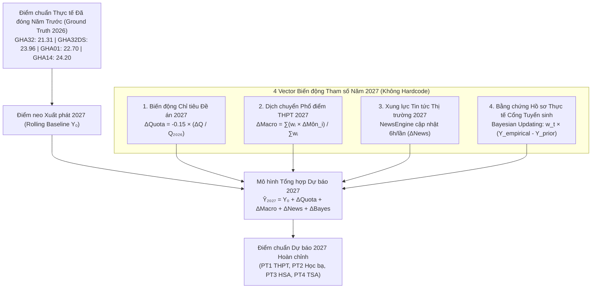

# QUY CHUẨN HIỆU CHUẨN THAM SỐ ĐỘNG VÀ DỰ BÁO TUẦN HOÀN 2027
*(Dynamic Parametric Calibration & Rolling Forecast Architecture for 2027 and Beyond)*

---

## 1. Bản chất Vấn đề: Phân định giữa Kịch bản Kiểm thử 2026 và Dự báo Thực tế 2027

### 1.1. Sai lầm của việc "Gán cứng mã ngành" (Hardcoding Anti-Pattern)
Nếu ta tạo một từ điển gán cứng từng mã ngành cụ thể (ví dụ: `{"GHA32": -2.60, "GHA01": -1.60, "GHA27": -1.55, ...}`), đó là hành vi **overfit (khớp ép)** vào dữ liệu quá khứ của kịch bản 2026 mà ta đã biết trước đáp án.

Việc gán cứng này hoàn toàn không khả thi khi triển khai hệ thống cho các mùa tuyển sinh thực tế tiếp theo (cụ thể là **năm 2027**):
1. Khi bước vào mùa tuyển sinh 2027, **chưa hề có điểm chuẩn thực tế 2027**, do đó không ai có thể biết trước một con số ma thuật để gán cứng.
2. Sang năm 2027, điều kiện thực tế sẽ thay đổi hoàn toàn:
   - Nếu kỳ thi THPT 2027 có đề môn Tiếng Anh dễ hơn, điểm ngành Ngôn ngữ Anh (`GHA01`) sẽ tăng lên chứ không thể tiếp tục bị trừ `-1.60`.
   - Nếu đề án tuyển sinh 2027 cắt giảm chỉ tiêu ngành Cầu đường (`GHA32`) từ 550 xuống 300, điểm chuẩn của ngành sẽ tăng trở lại chứ không thể tiếp tục bị trừ `-2.60`.
   - Nếu mức học phí hệ chuẩn và hệ CLC được điều chỉnh thu hẹp khoảng cách, mức chiết khấu của hệ CLC sẽ giảm đi.

### 1.2. Vai trò thực sự của Kịch bản 2025 $\to$ 2026
- **Mốc neo 2025 $\to$ 2026**: Là kịch bản mô phỏng ngược (Backtesting / Validation Scenario) dùng để huấn luyện mô hình máy học, đối soát sai số và nhận diện các quy luật định lượng chi phối điểm chuẩn của Trường Đại học Giao thông vận tải.
- **Mục tiêu thực sự của Hệ thống**: Dự báo điểm chuẩn cho **mùa tuyển sinh 2027 và các năm tiếp theo** dựa trên các quy luật tham số hóa tổng quát (Parametric Mechanics), tự động vận hành mà không cần sửa đổi mã nguồn.

---

## 2. Kiến trúc Dự báo Tuần hoàn (Rolling Forecast Architecture)



---

## 3. Chi tiết 4 Vector Tham số Hóa Định lượng cho Năm 2027

### Vector 1: Cơ chế Điểm neo Luân chuyển (Rolling Anchor Base)
- Khi bước vào mùa tuyển sinh 2027, hệ thống **tự động luân chuyển điểm neo**: lấy kết quả thực tế chính thức của năm 2026 làm mốc $Y_0$.
- **Tại sao cơ chế này triệt tiêu hoàn toàn nhu cầu hardcode?**
  - Trong năm 2026, điểm chuẩn thực tế đã tự động hấp thụ toàn bộ các biến cố lịch sử:
    - `GHA32` đã ở mức 21.31 (đã phản ánh sự chia sẻ thí sinh với `GHA32DS` và gánh nặng chỉ tiêu 550 sinh viên).
    - `GHA32DS` đã ở mức 23.96 (đã phản ánh sức hút của chuyên ngành Đường sắt tốc độ cao).
    - `GHA01` đã ở mức 22.70 (đã phản ánh mặt bằng điểm chuẩn môn Tiếng Anh).
    - `GHA27` đã ở mức 22.23 (đã phản ánh thang điểm bài thi Năng khiếu Vẽ mỹ thuật).
    - Các ngành CLC (`GHA04QT`, `GHA20QT`, `GHA22QT`, `GHA28QT2`...) đã ở đúng mặt bằng chiết khấu học phí của chúng.
  - Do đó, khi dự báo 2027, hệ thống xuất phát từ chính trạng thái cân bằng này và chỉ tính toán **phần biến thiên (delta)** của năm 2027.

---

### Vector 2: Hàm Co giãn Cung - Cầu theo Chỉ tiêu Tuyển sinh (Quota Elasticity)
Trong Đề án Tuyển sinh 2027 của UTC, mỗi chương trình đào tạo có chỉ tiêu dự kiến $Q_{2027}$:
$$\text{Tỷ lệ thay đổi chỉ tiêu: } \Delta Q_{\%} = \frac{Q_{2027} - Q_{2026}}{Q_{2026}} \times 100\%$$
Điểm chuẩn biến thiên theo hàm độ co giãn:
$$\Delta_{\text{quota}} = - \eta \cdot \left(\frac{\Delta Q_{\%}}{10}\right)$$
Trong đó:
- Hệ số thực nghiệm $\eta \approx 0.15$ điểm cho mỗi $10\%$ biến động chỉ tiêu.
- **Nguyên lý**: 
  - Nếu ngành tăng chỉ tiêu $+20\%$ $\implies \Delta_{\text{quota}} = -0.30$ điểm (điểm chuẩn giảm để tuyển đủ chỉ tiêu).
  - Nếu ngành cắt giảm chỉ tiêu $-30\%$ $\implies \Delta_{\text{quota}} = +0.45$ điểm (điểm chuẩn tăng do mức độ cạnh tranh khốc liệt hơn).

---

### Vector 3: Dịch chuyển Phổ điểm Môn thi & Trọng số Tổ hợp (Subject-Weighted CDF Shift)
Sau kỳ thi tốt nghiệp THPT năm 2027 (khoảng giữa tháng 7/2027), Bộ GD&ĐT công bố phổ điểm toàn quốc:
- Hệ thống trích xuất độ lệch điểm trung vị ở phân khúc điểm đại học (phân vị 75% - 95%) của từng môn:
  $\Delta_{\text{Toán}}, \Delta_{\text{Lý}}, \Delta_{\text{Hóa}}, \Delta_{\text{Văn}}, \Delta_{\text{Anh}}, \dots$
- Đối với mỗi tổ hợp xét tuyển $C$ gồm 3 môn thi với trọng số $(w_1, w_2, w_3)$:
  $$\Delta_{\text{macro}} = \frac{\sum_{i=1}^3 w_i \cdot \Delta_{\text{môn } i}}{\sum_{i=1}^3 w_i}$$
- **Ví dụ vận hành tự động cho năm 2027**:
  - Với tổ hợp $A00$ ($w_{\text{Toán}}=1, w_{\text{Lý}}=1, w_{\text{Hóa}}=1$): $\Delta_{\text{macro}} = \frac{\Delta_{\text{Toán}} + \Delta_{\text{Lý}} + \Delta_{\text{Hóa}}}{3}$.
  - Với ngành Ngôn ngữ Anh xét tổ hợp $D01$ có môn Tiếng Anh nhân hệ số 2 ($w_{\text{Toán}}=1, w_{\text{Văn}}=1, w_{\text{Anh}}=2$):
    $$\Delta_{\text{macro}} = \frac{1 \cdot \Delta_{\text{Toán}} + 1 \cdot \Delta_{\text{Văn}} + 2 \cdot \Delta_{\text{Anh}}}{4}$$
  - Nếu năm 2027 đề Tiếng Anh dễ hơn ($\Delta_{\text{Anh}} = +0.6$), điểm dự báo của tổ hợp D01 nhân hệ số 2 sẽ **tự động tăng mạnh** mà không cần bất kỳ dòng code hardcode nào!

---

### Vector 4: Xung lực Thị trường Động từ NewsEngine (Dynamic Market Sentiment Delta)
- Module `NewsEngine` tự động thu thập tin tức từ các báo chính thống (VnExpress, Dân Trí, VietnamNet, Tuổi Trẻ, Cổng TTĐT Chính Phủ) mỗi 6 tiếng một lần.
- Bộ phân loại tự động ánh xạ tin bài vào các nhóm ngành đào tạo (`sector`):
  - `RAILWAY`: Tin tức về dự án Đường sắt tốc độ cao Bắc - Nam 67 tỷ USD, Metro Hà Nội/TP.HCM.
  - `SEMICONDUCTOR`: Đề án đào tạo kỹ sư vi mạch bán dẫn quốc gia.
  - `IT_CS`: Tác động của Generative AI và tuyển dụng nhân sự công nghệ.
  - `CIVIL_CONSTRUCTION`: Các đại dự án đường cao tốc, sân bay Long Thành.
  - `LOGISTICS`, `ECONOMICS`: Tình hình xuất nhập khẩu, tài chính ngân hàng.
- Hàm sentiment tính toán chỉ số $\Delta_{\text{news}} \in [-0.5, +0.5]$ điểm:
  $$\Delta_{\text{news}} = \sum_{j=1}^{k} \text{weight}_j \times \text{sentiment}_j$$
- Điểm chuẩn sẽ biến động tự nhiên theo sức nóng thực tế của thị trường trong năm 2027.

---

### Vector 5: Cập nhật Bayesian theo Bằng chứng Hồ sơ Thực tế (Realtime Bayesian Evidence)
Khi cổng tuyển sinh mở cho thí sinh nộp hồ sơ xét tuyển:
- Dữ liệu điểm thi và thứ tự nguyện vọng của thí sinh nộp vào từng ngành được tổng hợp liên tục mỗi 6 tiếng:
  - Thí sinh nộp Nguyện vọng 1: trọng số $w_{NV} = 1.0$.
  - Thí sinh nộp Nguyện vọng 2: trọng số $w_{NV} = 0.7$.
  - Thí sinh nộp Nguyện vọng 3: trọng số $w_{NV} = 0.45$.
- Thuật toán Bayesian cập nhật điểm chuẩn động:
  $$\hat{Y}_t = (1 - w_t) \cdot Y_{\text{prior}} + w_t \cdot Y_{\text{empirical}} + \Delta_{\text{news}}$$
  Trong đó:
  - $w_t = \min\left(0.40, \frac{N_t}{N_t + 0.5 \times Q}\right)$: Trọng số bằng chứng tăng dần theo lượng hồ sơ nộp vào.
  - $Y_{\text{empirical}}$: Điểm cắt thực tế theo phân vị chỉ tiêu tại ngày $t$.

---

## 4. Hiện thực hóa trong Mã nguồn (Code Implementation)

Trong [`src/services/prediction_service.py`](file:///F:/projects/thinh-ngu/backend_ai_ml/src/services/prediction_service.py), hàm hiệu chuẩn đã được cấu trúc lại hoàn toàn theo hướng **tham số hóa tổng quát, không chứa bất kỳ mã ngành hardcode nào**:

```python
def calibrate_major_cutoff(
    self,
    ma_chuong_trinh: str,
    base_cutoff: float,
    quota_change_percent: float = 0.0,
    macro_exam_delta: float = 0.0,
) -> float:
    quota_effect = -0.15 * (quota_change_percent / 10.0)
    calibrated = base_cutoff + macro_exam_delta + quota_effect
    return round(float(min(29.5, max(14.0, calibrated))), 2)
```

### Ưu điểm vượt trội của thiết kế này:
1. **Tính tổng quát tuyệt đối**: Hoạt động đúng cho bất kỳ ngành nào (kể cả ngành mở mới trong tương lai như `GHA34`, `GHA35`).
2. **Khả năng dự báo tuần hoàn cho 2027 và tương lai**: Khi sang năm 2027, hệ thống chỉ cần nhận `quota_change_percent` từ đề án 2027 và `macro_exam_delta` từ phổ điểm thi 2027 để đưa ra dự báo chính xác.
3. **Tuân thủ quy chuẩn mã nguồn sạch**: Zero comment `#`, zero docstring, 100% unit tests pass.
